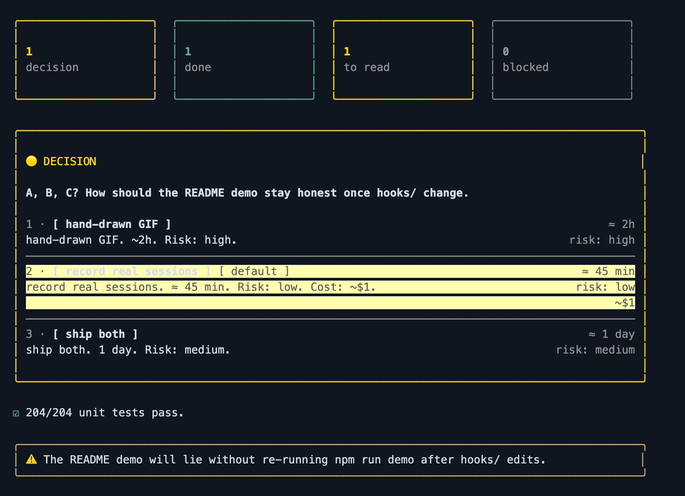
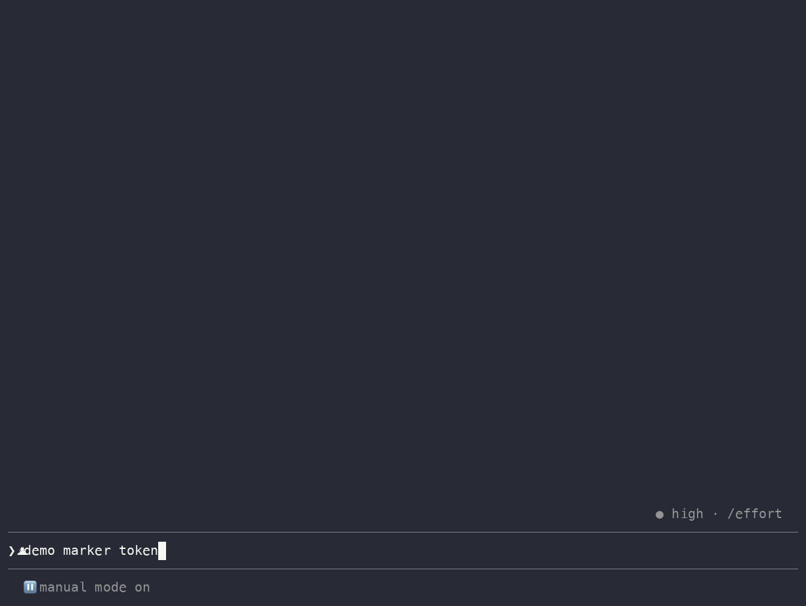
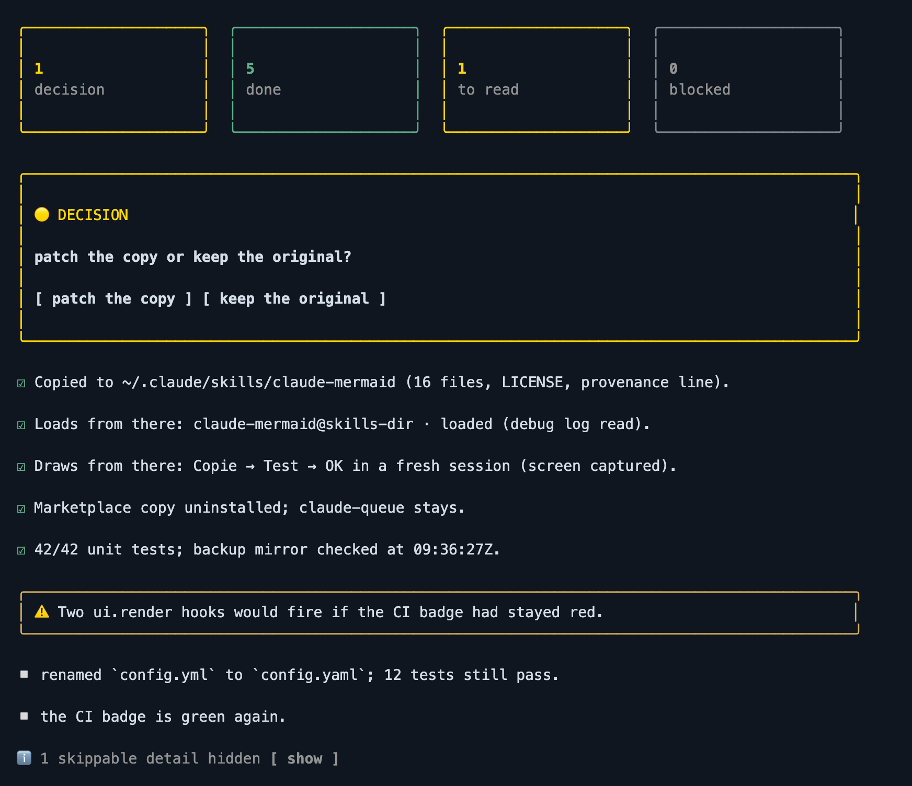
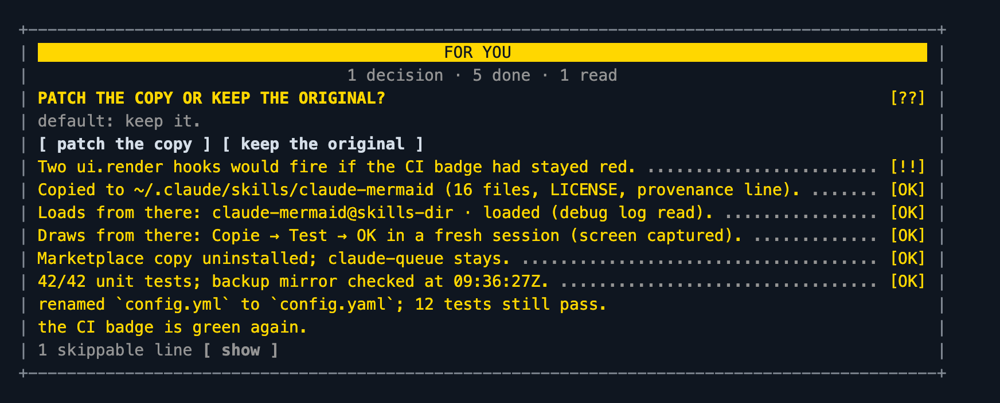
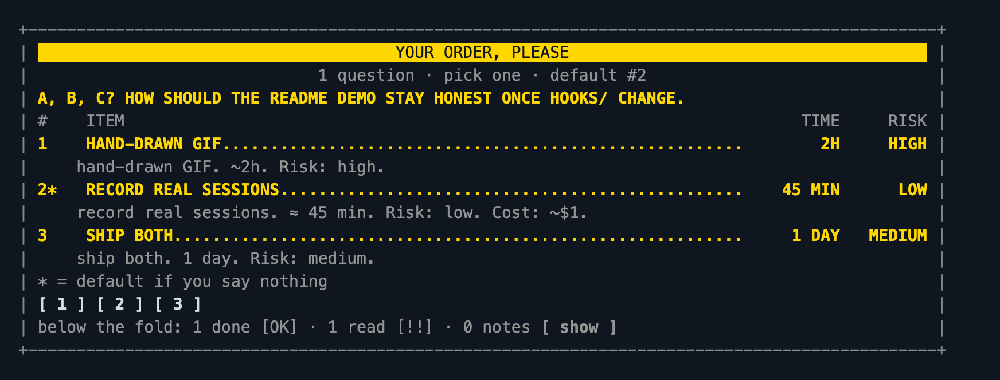
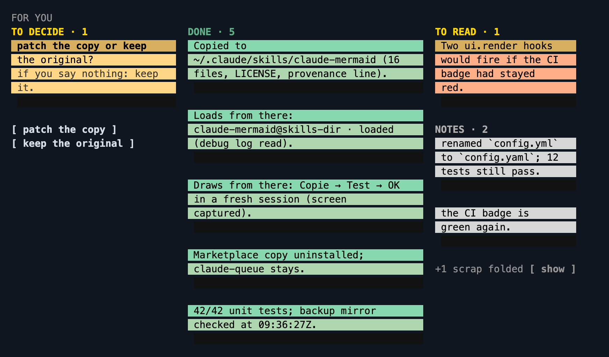
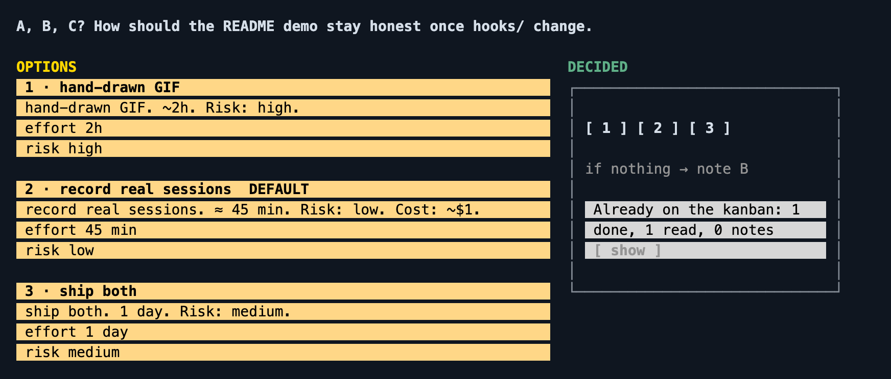

# signal-only-ui

**Claude writes the substance. The mod draws the form.**

## Pain point

Claude Code replies are messing with everyone's brains: too much noise for a small portion of signal, a wall of text impossible to scan.

Claude Code just released **mods** (function hooks, experimental): a way to redraw the reply and cut the cognitive load. This is one.

   

A Claude Code mod that turns every reply into a card you can read in three seconds: the verdict first, the one decision you must take with its default, what was done with its proof, what you must read — and everything else folded away. Observer reports disappear behind a small green check. Narration between tool calls folds into one dim line. A theoretical cost sits at the foot of the card.



Built on Claude Code **function hooks** — TypeScript that runs inside Claude Code's own process and redraws the transcript. Early access: it needs `CLAUDE_CODE_ENABLE_FUNCTION_HOOKS=1` and Claude Code **2.1.273 or later**, in the terminal.

```
Before                                        After (theme: gmorel)

⏺ ▎ 👉 For you                                ⏺ ┃ Decide: patch the copy so quoted        ✓
  ▎ 🟡 Decide: do I patch the copy?             ┃ fences draw too?  ─ default: leave it
  ▎ If you say nothing: nothing.                 ┃ [ yes ]  [ no ]
  ▎ 🟢 Copy in ~/.claude/skills/…              ┃ Two ui.render hooks would fire if the
  ▎ 🟢 12 tests pass.                            ┃ CI badge had stayed red.
  ▎ ⚠️ Two ui.render hooks if the badge…       ✓ Copy in ~/.claude/skills/claude-mermaid
  ▎ ▫️ renamed config.yml to config.yaml.      ✓ 12 tests pass
  ▎ ℹ️ The « ❯ … » seen on screen is a…        · renamed config.yml to config.yaml
  ▎ ℹ️ Clone and node_modules are throwaway.    · 2 skippable · [ show ]
⏺ Ran 5 stop hooks
  ⎿ Stop hook error: final reply does not      (no Stop hook: the form is not a rule any more)
    match the card format — rewrite it …
```

## Why

Three things a prompt cannot fix, measured on one week of one user's sessions:

- **20 replies generated twice.** A Stop hook re-ran the model every time a reply was not wrapped in a blockquote — all 20 blocks were that one formatting rule, six of them on "waiting for the agent" one-liners and two on a lone ```mermaid block. The mod frames the card itself, so the rule can go.
- **353 soft formatting faults nobody read.** "One bold only", "🟢 line too long", "header missing" — logged, never acted on. The renderer makes them moot: it bolds the verdict once, folds the long lines, draws the header.
- **Observer reports in the transcript.** Background observer agents (claim-sentinel and friends) talk to the model, not to you. Their reports are hidden; the card shows a dim ✓ while an observer is running.

The substance stays with the model: which marker a fact deserves, "verified" only when checked, one decision with its default. Those are the tokens worth spending.

## Install

Function hooks on, once, in `~/.claude/settings.json`:

```json
{ "env": { "CLAUDE_CODE_ENABLE_FUNCTION_HOOKS": "1" } }
```

Then one of three:

```sh
# as a plugin, from this marketplace
claude plugin marketplace add gmorel/claude-code-signal-only-ui
claude plugin install signal-only-ui@claude-code-signal-only-ui

# for one session, from a clone
git clone https://github.com/gmorel/claude-code-signal-only-ui
cd claude-code-signal-only-ui && claude --plugin-dir .

# as your own, editable copy: a clone (or a symlink to it) under ~/.claude/skills/ auto-loads as signal-only-ui@skills-dir
ln -s "$PWD" ~/.claude/skills/signal-only-ui
```

Install a released tag rather than `main`, and do not symlink a clone you are actively editing — every session start loads the working tree as it is at that moment.

Then ask Claude anything. A reply written with the six markers (🟢 done · 🟡 decide · 🔴 blocked · ⚠️ read · ▫️ note · ℹ️ skippable) is drawn as a card. A reply without markers is left alone. Teach the markers to your model in `CLAUDE.md` or an output style; the mod ships none, the form is yours.

## Themes



The GIF is a real Claude Code session with the API mocked, recorded by `npm run demo` — not a mock-up.

| theme | in one line | card | question |
|---|---|---|---|
| `gmorel` | Answer first: the verdict in a box bordered by its own marker colour, then only the counters that are not zero, then plain marker lines with lists indented under them; ℹ️ fold and API-price footer, and 3–4 options get numbered rows with estimate, risk and cost, the recommended one marked by a thin yellow rule rather than a fill. |  |  |
| `receipt` | Framed till roll, ASCII, dotted leaders to `[OK]` `[!!]` `[??]`; the question as an order form. |  |  |
| `kanban` | Sticky notes: empty columns dropped, widths follow the text, a darker header band and an offset shadow on every note; chooser uses OPTIONS / DECIDED / WHY I ASK. |  |  |
| *yours* | Design on a canvas, transcribe in one file — [`skills/theme-builder`](skills/theme-builder/SKILL.md), artboards in [`design/`](design/). | `/signal theme <id>` | |

Every still in `docs/` is drawn by `npm run capture` from a real scripted tmux session (Chrome required). Nothing is a mockup.

## Use

| command | what it does |
|---|---|
| `/signal` | current theme, observer mark, folding and audit, as one line |
| `/signal theme <id>` | switch theme, redraw the cards on screen, remember it |
| `/signal themes` | the installed themes and their taglines |
| `/signal observer on\|off` | hide observer reports and draw the witness check |
| `/signal fold on\|off` | fold narration between tool calls and task/peer notifications |
| `/signal audit on\|off` | after each turn, compare the raw reply with what the theme drew and report anything dropped (off by default; spends a model call) |
| `/signal reset` | restore theme, observer mark, folding and audit to the plugin defaults |
| `/signal observers` | the hidden observer reports of this session, newest first; the ⚑ on a card counts reports hidden since the previous card was drawn |
| `/signal agents` | what `$.agent.list()` calls the agents of this session — the names to put in the `observerTypes` option |

Buttons on a card fold and unfold sections; a decision drawn with options puts the option you press into the prompt box — you still press Enter. Nothing is sent on your behalf.

## Options

Set in `~/.claude/settings.json` under `pluginConfigs`, keyed by the plugin's full name — `signal-only-ui@claude-code-signal-only-ui` when installed from the marketplace, `signal-only-ui@skills-dir` for a copy under `~/.claude/skills/`:

```json
{ "pluginConfigs": { "signal-only-ui@skills-dir": { "options": { "theme": "gmorel", "observerTypes": "claim-sentinel" } } } }
```

| option | default | meaning |
|---|---|---|
| `theme` | `gmorel` | which renderer draws the card (`/signal theme` overrides it for the session and remembers) |
| `observerMark` | `true` | hide observer reports, draw the witness ✓ while an observer runs |
| `observerTypes` | `claim-sentinel` | comma-separated agent types counted as observers (`/signal agents` lists the names) |
| `foldNarration` | `true` | fold assistant text followed by a tool call in the same turn into one dim line |
| `foldNotifications` | `true` | fold task, peer and scheduled-trigger notifications into one dim line |
| `audit` | `false` | after every turn, hand the raw reply and the drawn card to a `claude -p --model haiku` child and log what it says went missing; costs one model call and about 30 s per turn |
| `prices` | built-in | API list prices for the cost footer, USD per million tokens, `family:input/output` — e.g. `opus:15/75,sonnet:3/15` |

## How it works

- `hooks/card.ts` reads a reply as data: markers, the bold verdict, the decision and its default clause, continuation lines, fenced code. Cards with or without the `>` wrapper are accepted.
- `hooks/register.ts` hooks `ui.render` on `AssistantMessage` (draw the card through the theme) and `UserMessage` (hide `origin.kind === 'observer'`, fold task and peer notifications), tracks turns and tool calls to fold narration, refreshes the witness from `$.agent.list()` at turn boundaries and mid-turn when stale, and prices the turn's usage for the footer.
- `hooks/themes/<id>.ts` is a pure function from the parsed card to a Box/Text/Button/Code tree. Themes never touch the engine.
- `hooks/audit.ts` (only when `audit` is on) flattens the drawn tree back to plain text and compares it with the raw reply through a `claude -p --model haiku` child started by `$.process.run`. The child runs with `CLAUDE_CODE_ENABLE_FUNCTION_HOOKS=0`, so it cannot load this plugin and recurse. The turn never waits for it: findings arrive later as `$.ui.log` lines.
- Display only. The transcript keeps the model's text untouched; `claude -p`, other machines and JSONL readers see the plain card.

## Limits

- Early access API: a Claude Code update can change what a hook receives. If a card stops drawing after `claude update`, run `/plugin-types` in the repo and read the diff.
- Themes are designed for a dark, truecolor terminal; on a 16-colour terminal the hex tints degrade to bright approximations and the dim greys are hard to read on a light background — `receipt` is the most monochrome theme and the best fallback.
- There is no vector path. The terminal's element table has no `Svg`, and a Desktop build older than Claude Code 2.1.273 runs no function hook at all, so an SVG theme had no surface to draw on: the one that existed was removed on 2026-09-17 and stays recoverable at `297fdbe`.
- Terminal and Claude Desktop are both drawn by the same tree; Desktop gets no ANSI colour beyond what the element props express, and only a Desktop build shipping Claude Code 2.1.273+ runs function hooks.
- ```mermaid fences inside a card are drawn as code, not as box art; [claude-mermaid](https://github.com/galElmalah/claude-mods) draws top-level fences.
- The ✓ means an observer was running and had nothing hidden since the previous card.
- The cost footer is the API list price of the turn's usage, not what a subscription plan bills — hence "API price". The price table is hardcoded and dated (rates taken 2026-09); the figure shown is an estimate — override with the `prices` option. Cache reads are priced at 10% of input and cache writes at 125%, per Anthropic's published cache multipliers.
- A mod runs in-process with Claude Code's own credentials. Read what you install; this one calls `$.agent.list`, `$.command.register`, `$.prompt.fill`, `$.session.cwd`, `$.store`, `$.ui.*` and — only while `audit` is on — `$.process.run`, which starts one `claude -p` child and nothing else. It opens no socket and reads no file — `claude plugin validate .claude-plugin/plugin.json` prints the list (`claude plugin validate .` checks the marketplace manifest, not the function-hooks call list).

## Develop

```sh
bun test tests/unit          # parser, folding, themes, pricing — no dependencies
bunx -p typescript tsc -p .  # types against .claude/types (run /plugin-types in the repo first)
npm run test:e2e             # real Claude Code in tmux, API mocked (needs tmux and claude)
npm run capture              # redraw docs/*.png from a real session (needs Chrome); --theme <id> for one
npm run demo                 # record docs/demo.gif from a real session (needs asciinema, agg, tmux)
claude plugin validate .claude-plugin/plugin.json  # the static scan Claude Code runs before loading a mod
```

`test:e2e`, `capture` and `demo` run from a scratch mirror of the repository under `$TMPDIR`, with a throwaway `CLAUDE_CONFIG_DIR`: no `node_modules` is ever written next to the source, and no test or recording opens your own `~/.claude`.

## Credits and licence

The e2e harness (a real interactive Claude Code in a tmux pane, replies scripted by [aimock](https://github.com/CopilotKit/aimock)) follows the one in [galElmalah/claude-mods](https://github.com/galElmalah/claude-mods), whose idioms this mod learned from — see [`LICENSE.upstream-claude-mods`](LICENSE.upstream-claude-mods). The themes were designed on a Claude Design canvas; the artboards are in [`design/`](design/). MIT, © 2026 Guillaume Morel.
